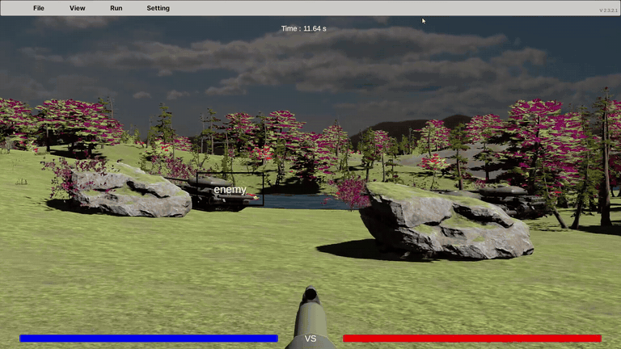
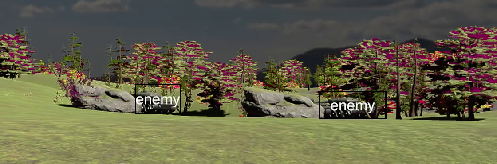
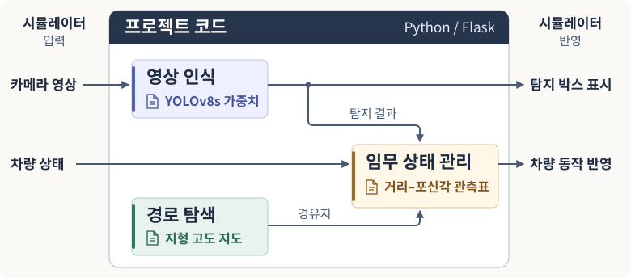
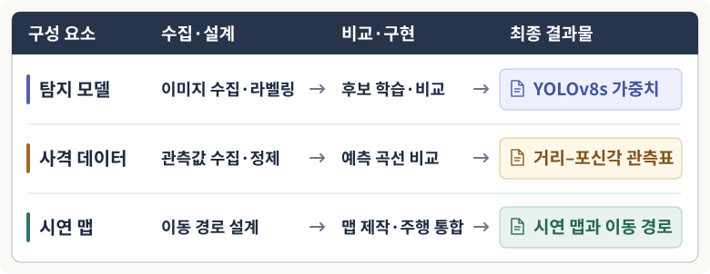
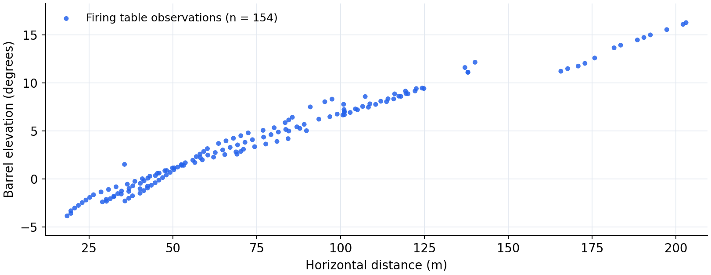
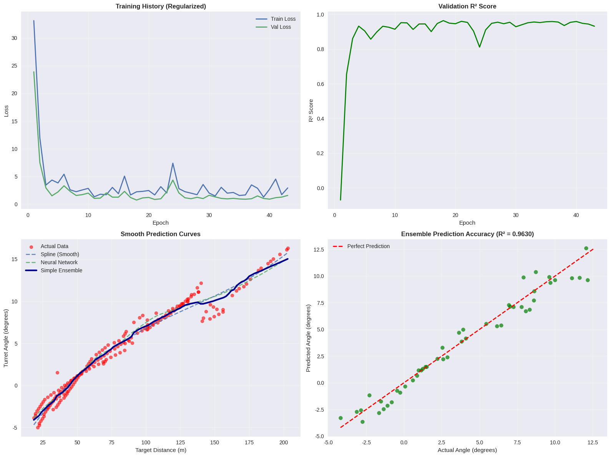

<h1>🛡️ 가려진 적 전차 탐지·자동사격·자율주행</h1>

육군 AI 직무보수 교육과정 (2025.06)

<strong>팀장</strong> · 시스템 설계·통합 · 일일 업무 분담 
객체 탐지 모델 파인튜닝 · 사격 데이터 수집·정제 · 발표 역할 수행

<strong>근접 장면 &nbsp; 왼쪽 바위 뒤로 전차가 드러나면서 <code>enemy</code> bounding box가 보인다. 
<a href="assets/demo.gif">전체 시연 GIF (16초)</a>

<strong>원거리 장면 &nbsp; 먼 거리의 두 바위 뒤로 차체 일부만 보이는 <code>enemy</code> bounding box가 표시된다. 
<a href="assets/detection-distance-full.jpg">3초 프레임 전체 보기</a>

## 🔎 탐지 모델 선정

**근접 교전의 성패를 가르는 핵심 요소인 은/엄폐한 적 식별 문제에 머신 러닝을 활용할 수 있을까?** 

객체 탐지 모델을 목표에 맞게 파인 튜닝하기 위하여, 팀원들과 주야간·날씨·거리·가림 정도·지형에 변주를 주어 데이터셋을 수집한 후 라벨링했습니다.

팀원 한 명과 함께 사전학습 모델의 종류와 학습 중 고정할(Freeze) 층의 범위를 바꿔가며 실험했습니다. Val mAP@50을 기준으로 후보를 추린 뒤, 별도 테스트 맵에서 가려진 전차에 박스가 나타나는 모습을 정성적으로 비교해 **YOLOv8s**를 선택했습니다.

**선택 모델의 검증 결과** · 학습 이미지 1,368장 · 100 epochs · 검증 이미지 349장

| mAP@50 | mAP@50–95 | Precision | Recall |
|:---:|:---:|:---:|:---:|
| **0.8154** | 0.4085 | 0.9189 | 0.8309 |

mAP@50은 예측 박스와 정답 박스의 겹침 비율(IoU) 0.50을 기준으로 계산했고, mAP@50–95는 기준을 0.50부터 0.95까지 0.05씩 높여 얻은 값의 평균입니다. 표의 수치는 검증 이미지 349장 전체에서 측정한 결과입니다. [학습 손실 그래프](assets/detector-loss.png)

## 🧩 시스템 아키텍처

**Tank Challenge 2.0**은 장면을 생성하고 차량을 움직입니다. **팀이 구현한 Python 프로그램**은 Flask 서버로 시뮬레이터의 요청을 받습니다. 카메라 영상에서 전차를 찾고, 지형 지도로 구한 경유지와 차량 상태를 바탕으로 임무를 진행합니다. [영상 인식](tank_control/perception.py#L38) · [경로 탐색](tank_control/planning.py#L21) · [임무 상태 관리](tank_control/mission.py#L43)

팀원이 제작한 시연 맵에서 시스템이 잘 동작핟록 이동 경로를 설계하고 인식과 차량 제어를 통합했습니다. 포탑, 포신 제어에 활용하는 거리–포신각 데이터 또한 시뮬레이터에서 직접 수집했습니다. 지형에 따른 편차를 살펴보며 수평 거리 기준으로 정리한 **실측값 154개**가 프로그램에서 읽는 관측 데이터입니다. 해당 데이터를 활용할 다른 방법과 비교한 결과 표의 데이터를 직접 조회하는 방식이 가장 안정적으로 작동했습니다. [데이터 수집 영상](assets/firedata-collection.mp4) · [관측표 CSV](data/firedata.csv)

<strong>탐지 모델·관측표·시연 맵을 준비한 과정</strong>

<strong>거리–포신각 관측표에 담긴 실측값 154개 (산점도)</strong>

점 하나는 관측표의 한 행입니다. 가로축은 수평 거리, 세로축은 관측한 포신각입니다.

<strong>실측값과 예측 곡선 비교 (스플라인·신경망·앙상블)</strong>

측정값을 하나의 곡선으로 설명할 수 있을지 살펴봤습니다. 처음에는 선형회귀를 구상했고, 아래 실험에서는 스플라인·신경망·앙상블의 예측 곡선을 비교했습니다. 왼쪽 아래 패널은 각 곡선과 실측값을, 오른쪽 아래 패널은 앙상블 예측값과 관측값을 비교합니다. 위쪽 두 패널은 학습 중 손실과 검증 R²의 변화입니다.

## 🌱 연구 관심 형성의 계기

전차 시뮬레이션 프로젝트에서 프레임별 객체 탐지 결과를 활용해 대상의 위치를 추정했습니다.
그러나 정확한 3D 좌표 추정/추적은 제한적이었으며, 차량이 기동하는 상황에서는 화면 속 대상의 위치 변화가 카메라의 이동 때문인지, 대상 자체의 움직임 때문인지 구분하기 어려웠습니다.
이 경험을 계기로, 여러 프레임에서 동일한 대상의 관측을 연결해 움직임과 상대 위치의 변화를 추정하는 영상 이해 연구에 관심을 갖게 되었습니다.

### 시각언어모델(VLM)의 시공간 추론과 영상 질의응답

현재 주요 연구 관심은 **시각언어모델(VLM)을 활용한 영상 이해와 시공간 추론**입니다.
특히 영상 속 객체의 움직임과 공간 관계의 변화를 추론하고, **답변의 근거가 되는 시점과 객체 상태를 함께 제시하는 방법**을 연구하고 싶습니다.

이와 관련하여, 가려짐이나 시점 변화가 있는 상황에서도 동일한 점의 3차원 이동 궤적을 일관되게 추정하는 **3D point tracking**에도 관심이 있습니다.

## 📁 구현과 실행 환경

시연에는 방배동 벨리의 **Tank Challenge 2.0**을 사용했습니다. [시뮬레이터 공식 안내](https://tc.bvdev.co.kr/docs/start/overview) · [실행 안내](INSTALL.md)

[시스템 동작](docs/DESIGN.md) · [시뮬레이터 API](docs/API.md) · [Ultralytics YOLO](https://github.com/ultralytics/ultralytics) · [모델 가중치와 라이선스](models/README.md)
